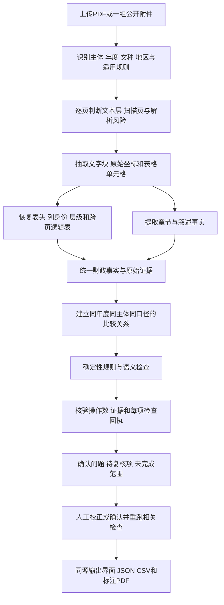

# GovBudgetChecker 可用性评估与优化报告

评估日期：2026年10月1日。评估对象：当前本地仓库 `21a7671`，分支 `feat/probe14-mrp-repair-20260930`。业务判定主规则按用户提供的 `AGENTS.md` 中 `v3_3_portable` 理解；代码、历史报告和外部资料分别作为实现证据、历史参考和政策适用参考。

本报告回答三个问题：为什么系统会误报或漏报；“解析 PDF、检查文字和表格、标注问题、输出”是否足够；怎样把已有系统改造成可以稳定用于实际审核的工具。

**结论：你的流程方向正确，但需要在解析与规则之间增加统一事实及证据层，在输出前增加真实性和检查完整性校验。现有系统值得继续完善，已有基础可以复用；当前证据还不足以认定它能对任意政府预决算材料给出可靠的完整审校结论。**

直接影响可用性的缺口集中在：目标表绑定和跨页恢复、年度与资金口径绑定、规则内部子检查的完成状态、AI与规则合并、证据真实性、导出范围说明，以及独立标准答案的规模。不能用“测试全绿”“规则很多”“问题数下降”替代业务准确率验收。

## 一 评估范围与证据限制

本次按文档识别、核心表、数字关系、口径说明、证据交付五条线并行检查，阅读真实上传入口及其调用链，运行当前代码回归、真实 PDF 重放和最小反例。没有修改业务代码，没有调用外部 AI，没有写入业务数据库。

| 本次工作 | 实际结果 | 能支持的结论 |
|---|---|---|
| 主代理相关测试 | 152项通过，涉及页面抽取、质量门、证据、引擎修复、探针修复、评测与报告导出 | 已有这些保护的回归用例正常；不能证明所有业务场景正确 |
| 解析线局部测试 | 48项通过 | 现有解析和结构化功能的既有契约正常 |
| 证据线局部测试 | 8项通过；与上面的测试可能重叠 | 不合并成“独立208项”；局部测试未覆盖新发现反例 |
| 4份冻结决算夹具重放 | 29条结果、10次规则未完成 | 规则在既有输入上的现状；夹具重放不度量PDF解析质量 |
| 14份已跑过的真实决算PDF重放 | 147条结果，11条高严重度，43次规则未完成，0份具备机器可消费的完整标准答案 | 可观察触发和未完成分布；整体精确率、召回率无法计算 |
| 现有黄金集重放 | 1份材料，3个缺陷组全部命中，机器评测P/R均为1.0 | 只证明这1份材料的已标注范围，不能外推其他模板 |
| 规则最小反例 | 5类复现，主代理再次执行所得输出完全一致 | 证实特定取数和状态判定缺陷，不代表生产误报率 |
| 页面视觉抽查 | 查看DOC-B1-009物理第26页三公表、DOC-B1-019物理第8页收入表 | 核对所抽查的原始数字及表头，不代表全量人工裁决 |

本地语料登记表共29条，当前只有1个 `golden.json`。尝试重放旧7份基准时，DOC-B1-001至006在本机缺少对应语料目录，6条装载失败如实保留。这是评估数据不完整，不能据此断言系统线上解析失败。

6份已登记为盲标留出集的材料及尚未冻结真值的DOC-B1-007/008未运行规则，保留独立评估用途。14份观察面材料已经用于修复，不能再当作独立盲测集。

本机8000端口有后端进程，但本次未核实该进程及实际Worker加载的代码指纹、生产配置、历史任务版本，也未进行真实AI、数据库或浏览器端到端验收。因此，“用户实际使用时的每一条误报是否来自当前提交”仍待核实。本报告中的当前缺陷来自当前代码和明确反例；历史材料中的问题另外标注。

## 二 对你提出流程的判断

你的流程可以保留为产品操作流程：

1. 上传材料。
2. 自动分析文字、表格及公开要素。
3. 显示问题并定位原页。
4. 人工复核。
5. 导出问题清单与标注材料。

实现层需要更细的步骤。尤其是文字和表格可以分别解析，但金额一致性检查必须在两者共享的“同一个财政事实”上完成。分别检查、最后合并报警，无法解决跨年度、同名项目、不同资金范围和年初预算与调整预算的混用。

**关键改进是：规则比较有身份、可追溯的事实；定位来自解析时保留的证据；每个应检查的事项都有执行回执。** 不宜让每条规则重新从全文猜金额，再到PDF里搜索相似文字补坐标。

“一组公开附件”同样重要。绩效目标、采购明细可能位于独立附件。系统只有一份PDF时，只能判断“当前输入未见”，不能直接推导“该单位没有公开”。建议支持材料包及附件清单，并保留当前输入是否完整的状态。

## 三 现有系统可以保留的基础

系统已经具备上传、任务处理、预算决算路由、规则执行、AI辅助、问题展示、复核及多格式导出。当前实现还有以下值得保留的保护：

- 文档画像统一文种、年度及主体候选，记录冲突；未知文种不直接套用预算或决算专项规则。
- `RuleOutcome` 区分通过、发现问题、不适用、数据不足、解析失败、执行异常；未完成检查允许保留已经确认的部分问题。
- 严格字段抽取和 `Decimal` 金额工具已能区分缺值与零值，并提供按原始单位、精度计算的舍入包络。
- 检查义务台账记录应检查而未实现、未执行或未完成的事项。
- 质量门已把扫描页、低覆盖、类型年度不明、规则执行异常和义务未完成等纳入 `review_required/incomplete`。
- 有PDF标注、复核状态持久化、回放脚本、语料身份校验和版本留痕。

因此，建议在已有代码上分阶段收敛数据契约及规则入口。大规模重写、增加模型调用次数、先扩展界面功能，都不应排在审校质量缺口之前。

## 四 当前可复现的关键问题

下表中的级别针对系统缺陷的影响；不是对某份政府材料作严重度判定。P0表示影响核心结论、证据或漏查，应先修；P1表示紧随其后的可用性改造。所有系统问题的PDF页码、bbox均不适用，具体源码位置列在后文。

| 编号 | 优先级 | 已确认现象 | 对实际使用的影响 |
|---|---|---|---|
| SYS-01 | P0 | 主规则分析与结构化入库使用两次解析，后者在问题生成后运行 | 优质结构化事实未成为主审校唯一依据，旁路改善不一定修复规则报警 |
| SYS-02 | P0 | 预算按目标页“最大表”选表，最多直接追加下一页 | 同页多表错绑、跨三页漏读、把另一张表接成续表 |
| SYS-03 | P0 | BUD-107从全文取首次匹配金额 | 上年说明可与本年表比较，产生跨年误报 |
| SYS-04 | P0 | 三公预算及部分回退路径固定按数字位置映射 | 合法列序变化可产生4条错配报警 |
| SYS-05 | P0 | 三公只完成合计比对，缺5个分项仍记pass | 义务台账可能把局部完成当完整完成，形成漏查 |
| SYS-06 | P0 | 双模式匹配后只保留AI项；冲突键和枚举不一致 | 更强规则证据隐藏，冲突同时记一致，合并异常触发整支回退 |
| SYS-07 | P0 | 未知页码转1，规则说明可充当原文，证据门主要查非空 | 证据看似完整，实际无法支持页面上的判定 |
| SYS-08 | P0 | 执行的规则注册表、YAML展示及容差配置没有完整统一 | 改配置或版本名不一定改变实际判断，无法可靠回放 |
| SYS-09 | P0 | 只有1份机器标准答案，14份观察面无完整真值 | 整体误报率及漏报率没有可靠验收依据 |
| SYS-10 | P1 | 当前主链检测扫描页但不执行OCR；文本覆盖不等于表格数字正确 | 扫描件只能提示复核，部分有文本材料也可能错列漏行 |
| SYS-11 | P1 | 表名或首个文本命中可以成为bbox兜底；翻页未按证据页过滤 | 标到表头、同名首行或无关页面，降低人工信任 |
| SYS-12 | P0 | Word空问题写“未发现明显问题”，CSV/PDF未完整保留未完成范围 | 系统内待复核，下载后却可能被理解为无问题 |
| SYS-13 | P1 | 固定预算九表与portable公开要素、条件性政策不一致 | 不同模板、附件结构或资金适用性被硬编码处理 |
| SYS-14 | P1 | 人工反馈尚缺结构化归因及受控进入黄金集的路径 | 同类误报难以系统治理，漏报也难以量化 |
| SYS-15 | P0 | 入库事实保存原数字，单位只附在维度提示中 | 若直接作为统一事实层消费，等值不同单位会被比较成不同金额 |
| SYS-16 | P0 | 入库以表种和行列号作为唯一键，缺少独立表实例身份 | 一份文件中的汇总、本级或不同年度同种表存在误合及覆盖风险 |
| SYS-17 | P1 | 连写封面含“财政局”时可能覆盖“部门决算”的主体判定 | 部门材料可能被分到政府层级，影响适用规则和完成范围 |

### 1 主审校和结构化旁路没有收敛

真实上传入口是 [api/main.py](</Volumes/workSSD/software development/GovBudgetChecker/api/main.py:1183>)。主链先得到 `page_texts/page_tables`，构建Document并运行传统或双模式分析；随后在 [结构化入库阶段](</Volumes/workSSD/software development/GovBudgetChecker/api/main.py:1609>) 调用另一条 `PDFParser → TableRecognizer → FiscalFactMaterializer` 链。

[structured_ingest_runner.py](</Volumes/workSSD/software development/GovBudgetChecker/src/services/structured_ingest_runner.py:214>) 显示这些事实生成发生在旁路。旁路能补充表识别、入库和质量门信息，但没有让全部生产规则重新基于同一批结构化事实判定。

建议建立独立于数据库的解析结果对象，先生成事实及证据，再供规则、AI上下文、定位和入库共同消费。数据库是持久化方式，不应是生成可靠事实的前置条件。复用已有解析组件，避免再造第三套解析器。

### 2 预算目标表及跨页关系仍在猜测

[_get_budget_table_rows](</Volumes/workSSD/software development/GovBudgetChecker/src/engine/budget_rules.py:617>) 找到页级表题后选最大表；没找到合计行时，只拼下一页最大表，没有验证下一页表的身份。

本次反例中，小收支表与较大无关表同页出现，实际选中了无关表。现有文旅预算夹具的T2、T3、T5分别跨3页，现函数只返回前2页；第三页分别有5、5、9行未纳入。跨页合成反例还能把采购表拼到功能分类表。

应把“一页上的表格区域”和“跨页的业务逻辑表”分开建模。续表至少核对表题或表号、表头路径、列位置、单位、科目域、上下页边界。表内层级关系只有在相关行已完整恢复时才能加总。禁止用“调整解析直到合计相等”选择结果，这会把真实错误修平。

### 3 数字相近不代表事实可比

[BUD-107](</Volumes/workSSD/software development/GovBudgetChecker/src/engine/budget_rules.py:2371>) 对全文首次匹配“收入预算”“支出预算”。真实建管委夹具原为pass，只在首页追加明确的2025年历史收入、支出预算213012万元，本年表和正文不动，就出现2条“不一致”，表数为328661.81万元。

这是规则事实绑定错误。需要将主体、年度、指标、资金范围、预算阶段、合并范围和原文位置作为比较前提。遇到多个候选，应保留歧义并要求证据，不能取第一个、最近一个或数值最接近的一个。

### 4 三公列序和子检查状态不可靠

[common_rules.py](</Volumes/workSSD/software development/GovBudgetChecker/src/engine/common_rules.py:186>) 的旧路径按“合计、出国、接待、公车小计、购置、运行”固定取位。预算表改成“合计、出国、公车小计、购置、运行、接待”，数值与文字一致，仍出现4条错配，其中1条error。

另一个反例只在文字中披露合计30万元，表内各分项完整。CMM-001只核对合计后就返回pass，[缺数据判断](</Volumes/workSSD/software development/GovBudgetChecker/src/engine/common_rules.py:622>) 仅在所有字段都无法比对时才转不足。外层六态和质量门无法发现规则内部假通过。

应为“合计、出国、公车小计、购置、运行、接待”分别产生回执，区分原文确实未披露、系统抽取失败、可比较且一致、可比较且不一致、不适用。按全部适用子项的状态聚合，部分缺失不能变成整项通过。

### 5 AI与规则的合并会影响正式问题集合

[merge_findings.py](</Volumes/workSSD/software development/GovBudgetChecker/src/services/merge_findings.py:41>) 对匹配项总是选AI的ID。界面复核和导出通过 `merged_ids` 取条目，因此规则项更强的证据不会自动保留。

内存复现显示：AI为medium、规则为high时，最终代表项仍是AI；金额100与90发生冲突，却同时统计1个agreement。冲突产生键 `match_0`，检测时使用 `match_0_0`，键不一致。严重度冲突产生 `severity-mismatch`，但 [ConflictItem](</Volumes/workSSD/software development/GovBudgetChecker/src/schemas/issues.py:280>) 枚举不接受它，触发校验异常，随后 [analyze_dual.py](</Volumes/workSSD/software development/GovBudgetChecker/src/services/analyze_dual.py:410>) 整体回退规则模式并清空AI结果。

应按事实身份和证据关系合并，保留两个来源、全部证据和原始结论。冲突进入待复核，不应凭来源强制选AI。单条合并失败应保留两条原结果及错误回执，不能丢掉整支分析结果。

### 6 有证据字段不等于有真实证据

[EngineRuleRunner](</Volumes/workSSD/software development/GovBudgetChecker/src/services/engine_rule_runner.py:63>) 将无效页码转为1，并在缺原文时用问题说明填证据。[evidence_guard.py](</Volumes/workSSD/software development/GovBudgetChecker/src/services/evidence_guard.py:148>) 判定的是“有正整数页码，且有非空文本或有效形状的bbox”，不验证文本是否在该页、页码是否越界或数字是否来自相应单元格。

内存反例中，没有原文和定位的规则项被转为第1页并判证据完整；第999页和不存在的文本也能通过字段完整校验。现有质量门值得保留，但这个证据入口可以污染它的输入。

需要将 `message` 与 `quote` 分开。原文引用绑定文件哈希、物理页、文本块或单元格ID；金额类问题附操作数、单位、期间、计算式和结果。unknown页码保持null。证据完整、引用已核实、坐标已核实分别记账；规则与AI采用相同的真实性要求。

### 7 配置与portable主规则需要明确对应

[EngineRuleRunner.run_rules](</Volumes/workSSD/software development/GovBudgetChecker/src/services/engine_rule_runner.py:230>) 接收加载的规则参数，但执行的是按文种选择的Python注册表。[容差方法](</Volumes/workSSD/software development/GovBudgetChecker/src/services/engine_rule_runner.py:495>) 未接入执行，金额及比例逻辑仍为占位。规则版本名留痕不能证明该版本YAML的条件和容差真正生效。

当前portable默认金额容差为0.5万元、比例容差为0.1，部分实现另用0.01或动态舍入包络；占位符和预算公开要素也存在主规则与实现差异。报告没有擅自替换这些政策。应将每个政策条件映射到实际实现及反例测试，记录实际生效容差，比例容差明确为百分点还是比例值。

[BUD-001](</Volumes/workSSD/software development/GovBudgetChecker/src/engine/budget_rules.py:1554>) 无条件遍历固定九表，与portable对基金、国资的条件性处理及采购、项目、绩效要素并不一致。该反例证明项目规则政策冲突，不能直接断言某年度地区不公开空表合法。财政部的公开操作规程区分政府与部门预决算，也涉及无数据空表及地方细化要求，应作为适用性资料而非自动覆盖用户主规则。[财政部公开操作规程](https://www.mof.gov.cn/gp/xxgkml/yss/201611/t20161121_2510868.htm)

### 8 标注与导出没有完整保留结论限制

[issue_bbox.py](</Volumes/workSSD/software development/GovBudgetChecker/src/utils/issue_bbox.py:203>) 有通过行列标题拼框、表名或首匹配补位置的路径；这些坐标可能只是导航。需要记录定位等级，精确数字框不能由表名替代。

[PdfViewerPane](</Volumes/workSSD/software development/GovBudgetChecker/app/app/components/review-workbench/PdfViewerPane.tsx:68>) 没有按当前页过滤选中问题的bbox，翻页后可能在另一页继续画旧框。高亮应从当前页对应证据引用取坐标。

JSON已包含覆盖与未完成信息；CSV、Word和标注PDF没有完整同源输出。特别是 [Word导出](</Volumes/workSSD/software development/GovBudgetChecker/api/routes/reports.py:712>) 在问题列表为空时直接写“未发现明显问题”，没有同步表达待复核和未完成范围。标注PDF主要绘制可定位问题，未定位项及未完成检查缺少完整附录。

应先形成统一报告对象，再生成各格式。“当前已完成的检查中未发现问题”与“检查未完成，不能给出完整结论”必须在下载文件中同样清楚。缺表等文档级问题放清单附录，不应硬标首页。

### 9 结构化事实需要先修复单位和实例身份

不能把当前数据库事实未经校验直接升级为唯一审校来源。[PDFParser数值转换](</Volumes/workSSD/software development/GovBudgetChecker/src/services/pdf_parser.py:729>) 去掉单位字符但不换算，[事实物化](</Volumes/workSSD/software development/GovBudgetChecker/src/services/fiscal_fact_materializer.py:198>) 把该数值直接写入amount。纯函数实测中，10000元、1万元、0.0001亿元本应均为1万元，原数值分别保存为10000、1、0.0001，单位仅作为附加提示。这是结构化旁路缺口，主规则已有StrictValue换算，不能说全系统都没有单位转换。

[单元格入库冲突键](</Volumes/workSSD/software development/GovBudgetChecker/src/services/pdf_parser.py:419>) 只有文档版本、表种、行和列；[表实例冲突键](</Volumes/workSSD/software development/GovBudgetChecker/src/services/table_recognizer.py:383>) 也只有文档版本和表种。一份PDF有部门汇总、本级两张同类表时，可能覆盖或误合。这里是代码和纯函数支持的风险，本次没有执行数据库写入复现。应引入独立物理表片段ID、逻辑表实例ID，并把主体、年度、口径纳入续表身份校验。

另外，[画像主体判定](</Volumes/workSSD/software development/GovBudgetChecker/src/services/document_profile_resolver.py:379>) 对“上海市普陀区财政局2024年度部门决算”这个连写封面反例输出government；带换行的现有good样本输出department。应依据报告标题语义区分财政局自身的部门决算与其发布的全区政府决算，并检查去掉换行等排版变化不会改变主体结论。

## 五 推荐的数据和判定方式

### 1 先定义财政事实的身份

建议复用现有字段与物化对象，统一增加以下语义。不是要求重建一套复杂数据库。

| 信息 | 示例及用途 |
|---|---|
| 主体与合并范围 | 某部门本级、部门含下属单位、某事业单位；避免部门与本部混用 |
| 年度与期间 | 2025本年、2024上年、年初、全年；年度未知不做确定性跨年比对 |
| 指标 | 收入、支出、基本支出、项目支出、三公合计、预算完成率等 |
| 资金范围 | 全口径、财政拨款、一般公共预算、基金、国资 |
| 预算阶段 | 年初预算、调整后预算、全年预算、决算；不能只写“预算数” |
| 科目或项目身份 | 功能分类编码及年度、经济分类域、项目ID、上下级关系 |
| 原始值及归一值 | 原文字符串、单位、小数精度、Decimal值、万元归一值 |
| 来源证据 | 文件哈希、物理页、印刷页码、逻辑表/章节、cell或span ID、bbox |
| 识别状态 | 已核实、缺失、多个候选、疑似错列、低置信度；不是统一补0 |

例如“财政拨款收入支出总计”通常涉及结转，并不能直接与“本年财政拨款收入”比较。三公有车小计时，合计只加出国、车小计、接待；不能再加购置和运行造成重复计数。基本支出还必须确认与人员、公用经费为相同资金范围及相同合并主体。

原始数字证据必须保留，归一化不改写它。OCR中无法确认的小数点、负号、千分位或数字，不得为了满足公式自动纠正。

### 2 原页解析要兼顾文字 表格和坐标

优先读取原生文本层；扫描或局部图像区域按页或区域补OCR。有文本层但字序错乱、数字列断裂时，同样要评估恢复质量。OCR只作为解析补充，不能证明财政事实正确。

当前pdfplumber和PyMuPDF可以继续使用。先建立页、文本块、表区域、单元格、行列的统一坐标约定；补齐无框表、多级表头、合并单元格、双栏收支总表、横向页面和跨页续表。是否增加其他解析工具，应通过同一批原始PDF的对比测试决定。

PyMuPDF官方接口可返回表单元格坐标和OCR TextPage，OCR结果需要显式复用；其坐标约定涉及未旋转页面。建议把这些能力接入统一证据层，而非让模型猜bbox。[PyMuPDF页面与OCR文档](https://pymupdf.readthedocs.io/en/latest/page.html)

解析质量至少分四层度量：页面可读性、表格结构完整性、关键数字恢复、财政事实身份正确性。整页字符很多，不代表某张表的金额列被正确提取。

### 3 规则统一比较事实并给子检查回执

每条规则应明确：适用条件、所需事实、可比口径、计算式、容差、缺数据处置、严重度依据、原始证据和建议。主规则ID与现有实现ID建立映射，例如portable的C-001/D-007对应哪些预算或决算checker。

金额采用Decimal；零、空白、破折号、无此项、未识别分别处理。默认沿用portable政策，舍入误差单独提示；若拟改为按精度计算容差，应作为政策变更独立评估及版本化，不悄悄通过改阈值减少报警。同比使用上年基期，百分比差异明确使用百分点。年初预算为0却声称完成该预算X%的情形保留为明确口径问题，不能替材料自行改成全年预算。

不能只记录“规则执行了”。以三公为例，每个分项表文比对、总分合计、公车购置运行、预算阶段、变化原因均有回执。表内层级加总按父子关系，不能把类、款、项同时累加。

未完成事项需要指出缺什么：例如“收入决算表续页有2行未恢复，无法验证21011款合计”，并允许确认其余已恢复关系。这样用户可以完成局部复核，而非面对整份文件一律待复核。

### 4 AI用于语义识别与候选 计算由代码负责

AI适合识别标题别名、叙述主语、原因说明是否对应变化、项目绩效描述及疑似科目用途错配。它应返回原文引用或现有证据ID、事实身份和不确定点。

金额加总、单位换算、分母、期间及资金口径匹配由确定性代码完成。AI发现数值疑点后，通过原始单元格重读及计算确认，才能晋升为正式问题。字段引用无法回到原文的项进入待复核。

不建议先建设向量库或仅用全文检索来解决数值勾稽：相似文字可以帮助找到候选章节，不能证明年度、主体和金额身份相同。也不应因为多个模型意见一致就把疑点当实证。

### 5 报告与标注使用同一结果对象

建议统一 `ReviewReport`，包括材料画像、适用规则、检查覆盖、确认问题、提示、待复核、未完成、未定位项、人工决定及版本指纹。所有界面和导出从它生成。

定位等级明确为“原始单元格”“原文片段”“表或章节区域”“无法定位”。前两类可以精确高亮；区域只能辅助导航。跨表问题保留两侧证据并显示计算关系。物理页索引与印刷页码分开存储。

PDF保留原件，另出标注副本和问题附录；无bbox问题仍在清单中。CSV需要覆盖/未完成表，可打包为多个CSV；JSON保留完整机器对象。每项有稳定问题ID及源证据链，编号与界面一致。

## 六 如何证明系统真正可以使用

### 1 建立独立标准答案

先定义一个可交付的范围，例如固定地区、固定年度模板的部门决算，再单独验收部门预算。部门、单位、区级政府应分别建配置，不能仅靠“预算/决算”二分。未知模板可以给有限范围结果及待确认事项。

建议起步收集30至50份真实材料，包含正确材料、真实问题材料、预算与决算、不同单位、不同年度、跨页、多表及扫描等；范围扩大后再扩充。这个数量是工作建议，不是足以证明98%准确率的统计保证。

标注必须覆盖整份材料应检查事项，不能只对系统已经报出的项判断对错，否则只能观察误报，无法发现漏报。记录真实缺陷、合理提示、正确负例、不适用和无法确认的事项。真实问题与人工注入问题分开统计。

开发集用于修规则；独立留出集在真值冻结前不运行待评引擎。按同一模板来源、部门及年度分组切分，避免同构材料同时进入两边。AI可以辅助初标，但不能独立裁定标准答案；有争议的财政口径由熟悉业务的人复核。

### 2 用多种指标同时验收

以下是建议首期门槛，需结合确定的业务范围确认，均不是当前已达成指标。

| 指标 | 建议首期目标 | 防止的假改善 |
|---|---|---|
| 正式问题精确率 TP/(TP+FP) | ≥98%，同时报告样本数与置信区间 | 大量错报但界面看似勤奋 |
| 适用范围内真实问题召回率 TP/(TP+FN) | ≥95%；重大数字/口径问题单列，建议≥98% | 关闭规则或把问题都转人工使误报下降 |
| 核心检查实际完成率 | 支持模板≥95%，不足事项必须可解释 | 用“运行过65条规则”替代真正查完 |
| 每份正确材料的正式误报数 | 单列分布，建议均值≤0.2；看异常材料而非只看平均 | 少数PDF被同根因连续轰炸 |
| 正式问题原文核验率 | 100%可回溯并支持结论 | 第1页兜底、说明当证据 |
| 正式问题物理页准确率 | 验收集100%；无法确认则不强行给精确页 | 问题判对但定位错页 |
| 精确高亮命中率 | 人工抽验≥99%，只统计声明精确定位的项 | 用表头区域凑定位率 |
| 不完整材料结论和导出一致性 | 错报为完整通过的次数为0 | 系统待复核，下载后看成无问题 |
| 人工复核负担 | 单列每份用时、待复核事项及校正后完成率 | 大量转人工却声称自动化可用 |

按预算/决算、主体、模板和文本/扫描分层报告。整体平均达标不能掩盖预算层或扫描层没有标准答案。指标为null、没有样本、跳过检查，不能自动算通过。

现脚本将 `1-precision` 命名为 `fpr_operational`，实际上是报警中的误报占比；传统FPR的分母为负例。建议界面分别称“报警误报占比”“每份误报数”“负例违规率”，避免不同分母混淆。

### 3 增加会暴露机制问题的反例

每修一类问题，保留正确样本、真实错误样本和输入变体。本次5个反例可以直接作为起点。

- 合法更换列序、分页、千分位、文本折行，结论应保持；单位等值变换后结论也应保持。
- 插入明确的上年度说明，不应影响本年比对。
- 在目标表同页放另一张表，不应改目标表身份。
- 将表扩展为3页、4页，完整行集应保持。
- 去掉某个关键单元格，应变成相应关系未完成，而非补0后通过。
- 正文合计正确但分项错误，不能只比较合计就结束。
- AI与规则有冲突、合并失败、定位失败时，原始结果和范围限制均应保留。
- 复核工作台翻页、缩放及导出应使用同一证据页与坐标转换。

这些测试验证业务不变量，价值高于只断言“返回列表”“bbox非空”或“PDF能下载”。

## 七 建议实施顺序和验收交付

| 阶段 | 工作内容 | 必须交付及验收 |
|---|---|---|
| 0 固定当前状态 | 核对运行API/Worker版本、配置、模型、旧任务；确定首期地区主体模板；冻结基线 | 运行指纹、输入哈希、规则映射、已支持与未支持范围；旧结果不冒充新分析 |
| 1 修复已复现缺陷 | 三公固定列序、全文首次金额、目标最大表、子检查假pass、合并键/枚举、页码兜底、导出范围 | 本次反例加入回归，全部修复；已有真实阳性保留；不通过删规则或降级凑结果 |
| 2 统一解析和证据 | 将结构化解析前置为共享输入；恢复逻辑表和多页单元格；补按需OCR | 同一PDF只生成一份有版本的事实与证据；规则、AI、入库、标注引用一致 |
| 3 统一规则和口径 | 主规则与checker映射，政策适用、统一数值工具、字段及关系回执 | 每个核心C/D规则有正反例和缺数据处置；容差等配置确实影响执行并留痕 |
| 4 完成人工闭环与导出 | 校正表身份/单位/期间/关键数字后重跑；根因去重；所有格式同源 | 确认问题、待复核、未完成、未定位项均可复核；格式之间结论一致 |
| 5 独立盲测和有限上线 | 全文真值冻结、留出集评测、分层门禁、试点记录人工用时 | 达到已确认范围的质量目标后发布；预算、扫描件、其他地区单独扩展验收 |

标准答案建设应从阶段0开始，与开发持续并行，不应等代码全部完成后才标注。修复前后比较同一冻结输入，保留解析器、规则实现及政策配置的实际哈希。

如果有1名后端工程师、可按需配合的前端工程师及持续参与的预决算复核人员，限定一套成熟模板，建议按4至8周安排首期工作；这是排期假设，不是承诺。几天可以修复明确反例，但跨模板准确率和盲测必须有真实标注支持。材料及人员不足时，先缩小首期支持范围。

## 八 人工反馈怎样真正改善系统

现有复核工作流继续保留，增加结构化原因：错表、错列、漏行、错页、单位、舍入、年度、资金范围、规则不适用、原文真实错误、其他未确认原因。记录用户校正后的事实与证据、原分析版本和决定版本。

“这条是误报”可以立即改变本次复核结果，但不应自动修改全局规则。经业务复核后，将案例加入开发回归集；独立验收案例另行冻结。人工确认已报问题可以用于precision统计；recall仍需要对全文独立标注，不能从点击确认数量推出来。

同一解析错误可能引发多个公式报警，应按来源事实和根因归并为一个主问题，保留受影响关系。不能仅按标题相似度去重，也不能把不同项目的同一句错误合并掉。

允许用户校正逻辑表、关键字段或证据位置，再只重跑受影响关系。这样可以把“待人工复核”变成有完成路径的工作项，而不是永久的兜底标签。

## 九 待进一步确认的事项

1. 用户实际使用的API和Worker是否运行当前提交，是否仍查看旧版本任务结果。当前端口有进程不等于进程已加载最新代码。
2. 首期究竟优先部门决算、预算与决算同等，还是多地区多模板。本报告暂建议先在固定范围建立可用版本，同时单列预算缺陷，不把预算视为已验收。
3. 完整材料包是否只有一个PDF，绩效及采购附件是否另行公开；这决定缺失判断的范围。
4. 当前AI供应商、模型、提示词和结构化输入在真实任务中的证据质量。本次没有调用真实AI，已发现的合并风险不依赖模型供应商。
5. 实际部门预算、单位预算、区级政府预决算的年度模板及适用政策。portable主规则继续作为默认，冲突需要明确映射和版本化。
6. 全部真实材料的标准答案及全部提示项的裁决。本次14份147条结果中的非高严重度项没有做全量人工裁决，43次未完成检查也不能换算成漏报条数。

这些限制不影响先修复本报告中已经复现的代码缺陷，但会影响最终发布范围和质量承诺。

## 十 最终建议

**保留你的产品流程，完善背后的事实、证据和完整性机制。** 首先修复会稳定制造错报或漏查的旧取数路径与合并逻辑，再让所有检查共享同一份结构化事实，最后用独立全文标注验收。

系统可用应表现为：用户看得到为什么报、原文在哪里、如何计算、已经查了什么、还有什么没查；修正后能重跑；下载报告保留同样的范围限制。在确认的模板和输入范围内用数据验证准确率，逐步扩大范围，才能形成可靠的实际工具。

## 十一 本次复核资料

- [主规则 AGENTS.md](</Volumes/workSSD/software development/GovBudgetChecker/AGENTS.md>)。
- [规则最小反例及可运行代码](</Volumes/workSSD/software development/GovBudgetChecker/outputs/system_assessment_20261001/rules_repro.json>)。
- [结构化系统问题清单](</Volumes/workSSD/software development/GovBudgetChecker/outputs/system_assessment_20261001/assessment_findings.json>)，对应SYS-01至SYS-17。
- [解析与续页复现](</Volumes/workSSD/software development/GovBudgetChecker/outputs/system_assessment_20261001/parse_repro.json>)。
- [证据与合并复现](</Volumes/workSSD/software development/GovBudgetChecker/outputs/system_assessment_20261001/merge_repro.json>)。
- [4份冻结夹具重放](</Volumes/workSSD/software development/GovBudgetChecker/outputs/system_assessment_20261001/frozen_replay.json>)。
- [当前14份探针评测](</Volumes/workSSD/software development/GovBudgetChecker/outputs/system_assessment_20261001/probe_metrics.json>)，其中P/R为null。
- [当前1份黄金集评测](</Volumes/workSSD/software development/GovBudgetChecker/outputs/system_assessment_20261001/golden_metrics.json>)。
- [7份基准装载记录](</Volumes/workSSD/software development/GovBudgetChecker/outputs/system_assessment_20261001/benchmark/20261001-143554/_run_manifest.json>)，包含本机6份材料目录缺失。
- [历史14份人工裁决记录](</Volumes/workSSD/software development/GovBudgetChecker/docs/B1_PROBE14_FPFN_ADJUDICATION_20260930.md>)及[修复对比](</Volumes/workSSD/software development/GovBudgetChecker/docs/B1_PROBE14_AFTER_MRP_对比报告.md>)。历史首轮部分误报来自同构推断，后续已订正；不是本次独立盲测。
- [现有CI业务门禁说明](</Volumes/workSSD/software development/GovBudgetChecker/docs/CI_BUSINESS_GATE.md>)，其说明已明确结构门禁不代表精确率和召回率。
