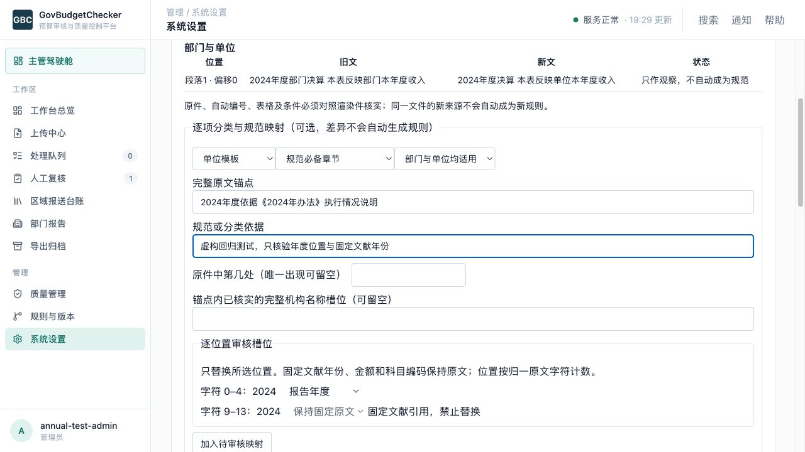

# 年度模板 v3：独立审核四项 P1 整改记录

日期：2026-10-28（本地时区）。这是开发方整改与复测记录，不是再次独立验收结论。原方案、原审核文件及前次 20 项交付证据保持不变。

## 结果与提交

在 `codex/annual-template-management` 的 `b97d6880` 上原样重现四项缺陷，然后修复并提交为 `8ed769ad`。专用 worktree 为 `/Users/zhangxingjin/.codex/worktrees/annual-template-management/GovBudgetChecker`，原始基线仍为 `b557e8b7`。没有合并原目录、部署、启用真实模板或提交真实材料复核决定。

| 审核项 | 已实施修复 | 永久回归与结果 |
|---|---|---|
| R1 文件名年度使模板被拒绝 | 模板选择独立回读合格原件封面年度、文种，克隆选择画像；同向文件名不再挡住模板，文件名独有或反向仍待核。不修改金额链路画像 | 覆盖数据库、冻结绑定、离线、独立规则四个入口；同向有/无文件名均为 conflict；反向或原件不足不加载 |
| R2 沿用全局替换固定年份 | 保存归一字符范围、槽位类型、原文及原始坐标；运行时倒序仅替换已审核范围，语义比较使用同一槽位规则 | 报告年、同比上一年及完整名称分别覆盖；《2024年办法》、2024.00 万元、编码保持原文；固定引用槽位被拒绝 |
| R3 高分孤立 OCR 被采信 | 高分之外必须通过共享 `bound_ocr_block()` 的原件/物理页/请求/原始预测/几何/模型绑定。失败候选保留待核文字，不进入证据视图 | 完整绑定正例可确定；孤立、错页、错原件、错模型、错请求、错预测、错变换及 NaN/Inf/bool/低分/超界均不能自动确定 |
| R4 引用章节和同页无关表视为完成 | 按整行、编号或有限折行核对标题；表名还须唯一关联逻辑表和对应物理片段的标题、页码、UID、bbox、行内容，OCR 表另核对绑定网格 | “尚未提供”及提及缺表不算完成；无关表、错页、无实例、未绑定 OCR 留待核；真实标题及正确表实例通过 |

实现位置：`src/services/material_writing.py`、`template_anchor_slots.py`、`template_anchor_checks.py`、`annual_templates.py`。永久反例见 `tests/test_annual_template_p1_regressions.py`；OCR 正例夹具保留完整绑定，不把门槛降成仅置信度。

## 界面与使用

仍采用已经确认的方案 A：“系统设置 → 模板管理 → 3. 审核与发布”。填写完整锚点后，逐个位置选择“报告年度／同比上一年度／完整机构名称”，不选则保留原文。《文献》内年份显示为固定引用，禁止选择为年度槽位。修改原文或候选名称会清除旧位置，避免陈旧坐标被重复使用。

浏览器在现有正常认证会话中实际打开修复页面、选择虚构来源、选定字符 0–4、保存虚构审核记录，并通过正常 API 回读了数据库。字符 9–13 的固定文献年份未被替换，2025 年实例化结果为 `2025年度依据《2024年办法》执行情况说明`。本次没有点击真实来源的审核或发布。

材料面板新增“待核 OCR 候选（未参与裁决）”说明；这些候选不显示为已验证 bbox 证据。D-2 仍是已批准版本、章节和完整句子的 low，并注明模板来源，没有扩大豁免。

## 数据与兼容

- 算法升级为 `material-writing-v3.3`，新草稿配置 schema 为 2。无需新增数据库迁移；沿用既有 0042–0044 表及不可变约束，槽位和来源位置存入审核配置 JSON。
- 已发布包、原件和年度绑定不迁移、不覆盖。旧包若只有 `annual_slot=true` 或名称标记而没有明确位置，附加要求转为“旧版槽位未记录具体位置，请重新逐位置审核”。不能把此状态算通过，也不能猜测替换。
- 要让旧锚点参与新判断，须由维护者核对原件、登记具体槽位并审核新包。配置语义比较保留固定引用；不能以年度变化名义隐藏实质变化。旧算法的跨年兼容证明不自动升级为新算法证明。
- 发布新包不触发历史重算。显式重算固定当前任务所选绑定、配置和算法；旧分析仍保留当时记录。写法人工决定独立于金额决定。

## 验证证据

证据目录：[annual-template-p1-20261028](validation/annual-template-p1-20261028/verification-summary.json)。每个证据文件另附 SHA-256 清单。

- 审核原脚本在旧 head 的四个 `reproduced` 均为 true；在修复后均为 false。脚本原样保留。它最后断言“全部缺陷应当存在”，所以修复后这个旧断言预期失败；回放器读取它已计算的结果，反向断言四项均不再复现。R2 旧布尔槽位现在待核，另有显式位置的正例测试证明正确章节能通过。
- 后端全量（含真实隔离 PostgreSQL）：**4721 通过、33 跳过、21 警告，319.99 秒**。全新测试库名在摘要中，显式校验 DSN 必须为本任务 127.0.0.1:25462 测试实例。没有把测试迁移接到业务库。
- 全量收集后补充 5 个分数边界，专项组最终 **59 通过、1 跳过**；该跳过是未配置 DSN 的专项进程中的数据库生命周期，它已在上述含数据库的全量中通过。专项与全量存在重叠，不累加为新的总通过数。
- TypeScript、前端全部单元脚本和生产构建通过。构建仍有既有 `useEffect` 的 `load` 依赖警告；实际槽位页面操作后，浏览器控制台捕获到的 warning/error 为 0。
- 33 项全量跳过仍为缺特定真实 PDF/冻结产物、缺 cv2、XLS 来源 opt-in、显式测试库逆向反例、macOS RLIMIT_AS 限制；完整原因保留在 `python-full.log`。未将它们算通过，真实预算验收仍未完成。
- 正常认证隔离服务 28743/3308：虚构材料只确认写法→持久队列重算→回读→后端进程重启→历史与 JSON/CSV/PDF/DOCX 导出均通过。写法修订 5 已应用；8 个历史版本保留；金额人工决定仍为空。重启仅操作已核实 cwd 的本任务 PID，没有操作 3000/18743。
- 10 条金额事实全字段一致，包括金额、单位、来源格/bbox、UID、org_scope。第一次重算跨越旧代码与本次修复代码：解析身份摘要因处理代码指纹变化而改变，初版脚本的“跨代码解析哈希不变”断言失败，已如实保留 `writing-upgrade-observation.json` 和逐项差异。原始事实哈希及金额全字段不变；同一修复代码下再做写法确认，解析内容及原始事实哈希均不变。没有修改哈希规则去掩盖变化。
- 真实模板草稿、既有发布包和年度绑定经前后比对均未改变。原方案两份哈希仍为 `93604b557a518297f14347f674f67ac79a11c7ff360cfcc5fafa7f163b17556d`；原目录 HEAD 仍为 `b557e8b7`；原审核输入及前次 20 项证据哈希全部一致。

## 再复核、发布与回滚

代码修复、自动回归和本地隔离运行已完成。四项 P1 需再次独立复核；独立业务标注、2022/2023/2025 等年度能力兼容及真实预算验收尚未完成。定向反例与虚构数据不能提供真值准确率或统计保证，本记录不宣称完整通过 v3 验收。

集成前由独立复核确认四项修复及新增反例；正式模板维护者随后核实真实下发来源、视觉转换、逐位置槽位和适用能力。审核通过后再生成不可变新包、登记年度绑定；不自动确认材料问题或重算历史。

尚未执行部署或合并。若后续受控集成需要回滚，先缩小/关闭新年度能力，保留所有历史，再按正常发布流程回退应用提交；不得改写旧包、删除审核或把旧布尔槽位恢复为全局替换。年度回滚生成新修订并核验原件。代码回退与模板年度回滚是两个独立动作，均需在目标环境验证。
